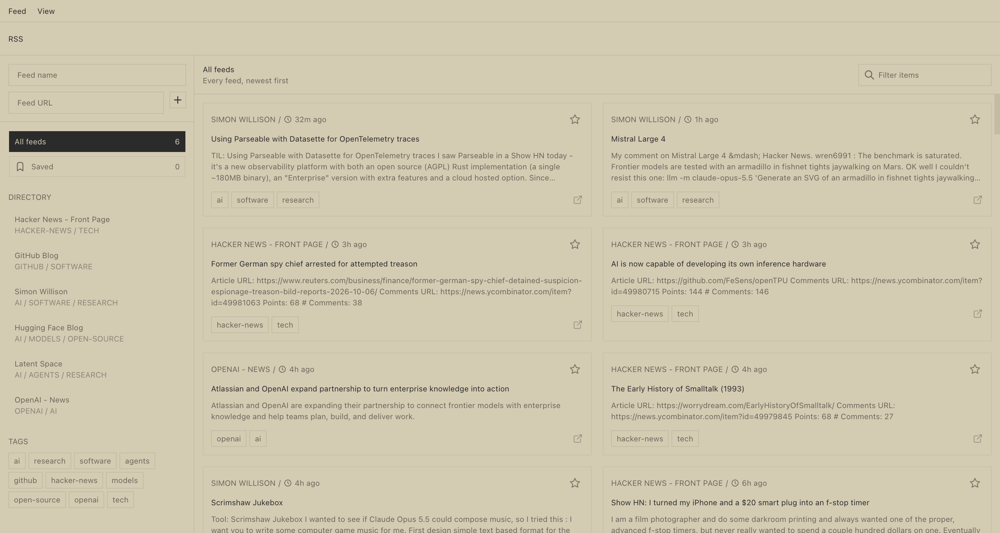

# rss

A feed reader that fetches live. A directory of feeds ships with it, you add
your own, and every item you star is kept. Nothing is crawled in the
background and no item store grows: items are fetched when you look, held in
memory for five minutes, and sorted newest first.



## Requirements

- [Bun](https://bun.sh)

## Run it

```sh
bun install
bun dev          # http://localhost:3000
```

Your subscriptions are in `./data/feeds.json` and your stars in
`./data/bookmarks.json`, both readable without the app. The starter directory
is `src/server/directory.json`; edit it to taste. `RSS_DATA_DIR` moves the
data, `PORT` changes the port, `RSS_ALLOW_PRIVATE=1` lets the reader fetch
from private addresses (off by default so a link cannot point it at your LAN).

Paste any feed URL into the sidebar to subscribe, or open `/?url=…` to read
a feed once without subscribing. The Feed menu refreshes, copies the feed
URL, or opens the source. `?feed=` bookmarks a view.

## API

| Route                                                  | What                                                |
| ------------------------------------------------------ | --------------------------------------------------- |
| `GET /api/feeds`                                       | Directory plus your feeds, with tag counts          |
| `POST /api/feeds`                                      | Subscribe: `{ url, name?, tags? }`                  |
| `PATCH /api/feeds/:slug`                               | Rename, re-point, or re-tag one of yours            |
| `DELETE /api/feeds/:slug`                              | Unsubscribe                                         |
| `GET /api/items?feed=all\|slug&url=&q=&limit=&fresh=1` | Live items; per-feed failures come back in `errors` |
| `GET /api/bookmarks?q=&feed=&limit=`                   | Starred items                                       |
| `POST /api/bookmarks`                                  | Star: `{ item, itemKey }`                           |
| `DELETE /api/bookmarks/:id` or `?itemKey=`             | Unstar                                              |

Errors come back as `{ error }`.

## CLI and MCP

Every API route is also a headless command and an MCP tool.

**CLI.** Every route is available from `bun run cli`. Start an API-only server
with `HOST=127.0.0.1 bun run headless`, or connect the CLI to the existing web
server. Run `bun run cli --help` for commands; `RSS_API_URL` or `--base-url`
selects the server. The executable is also declared as `rss-cli` for `bun link`.
See [CLI.md](CLI.md) for examples, all commands, file and streaming I/O, exit
codes, and `bun run test:cli` verification.

**MCP.** The app is an MCP server too. Every API route is a tool, over
streamable HTTP at `POST /mcp` on the running server, or over stdio with
`bun run mcp` (`--start` gives it an API-only server of its own). Connect an
agent with `claude mcp add --transport http rss http://localhost:3000/mcp`, or
point a stdio client at `mcp.js --start`. The executable is declared as
`rss-mcp`. See [MCP.md](MCP.md) for connecting, every tool, how files and
results are handled, and `bun run test:mcp` verification.

## Layout

| Path                                   | What                                            |
| -------------------------------------- | ----------------------------------------------- |
| `src/app/`                             | The page and its client                         |
| `src/server/feed.js`                   | RSS 2.0 and Atom parser, regex-based on purpose |
| `src/server/store.js`                  | Feeds, bookmarks, the item cache                |
| `src/server/directory.json`            | The starter directory                           |
| `server.js`                            | `Bun.serve`: the page plus `/api/*`             |
| `src/ui/`, `src/shell/`, `src/styles/` | The shared skeleton                             |

## License

MIT — see [LICENSE](LICENSE).
